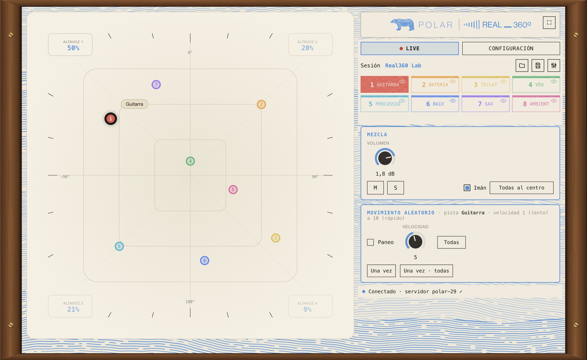
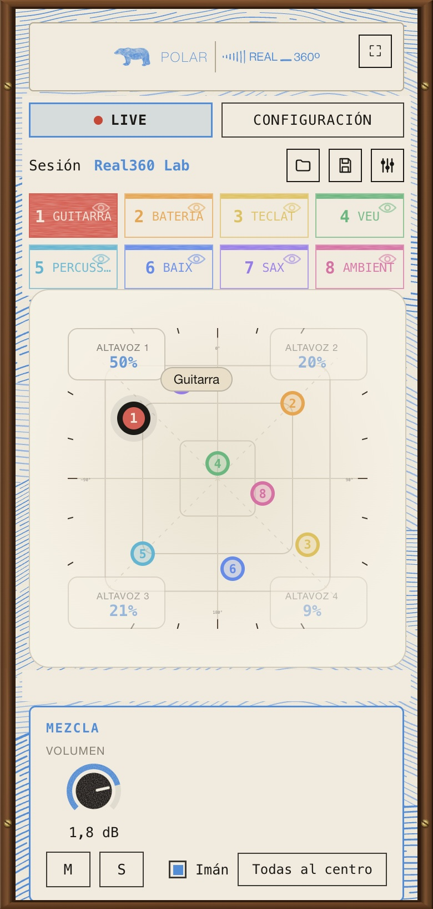
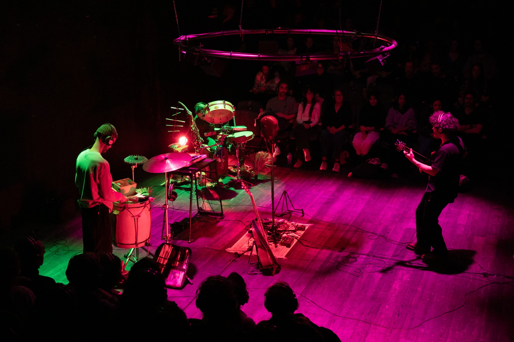

# Real360 Lab · POLAR

**Real360 Lab: Fusió Immersiva – Laboratori de Formats Escènics Híbrids**

Programari obert per posicionar so a l'espai (360°) des d'un DAW, des de l'ordinador o des del mòbil.
Desenvolupat per [REAL360](https://cotefournier.com) dins del projecte Real360 Lab de l'**Associació Panorama180**.

<p align="center">
  
  &nbsp;
  
</p>
<p align="center"><em>L'app POLAR a l'ordinador i al mòbil · La app POLAR en el ordenador y en el móvil</em></p>

*[Castellano más abajo](#castellano)*

> **Amb el suport de l'Institut de Cultura de Barcelona – Ajuntament de Barcelona.**
> Convocatòria de subvencions per a inversions en tecnologies de la informació i comunicació per a projectes
> d'experimentació i innovació en l'àmbit de la cultura, 2025.
<!-- REVISAR: frase y logo exactos que exigen las bases de la convocatoria. -->

---

## Català

### Què és

POLAR és un conjunt d'eines per moure fonts sonores per un anell d'altaveus:

| Part | Carpeta | Què fa |
|---|---|---|
| **App POLAR** | [`apps/polar`](apps/polar) | Aplicació d'escriptori (Electron + Node). Un pad on cada pista és un punt de color: la mous amb el ratolí o amb el dit des del mòbil (la mateixa xarxa wifi). Envia la posició per MIDI i al plugin per UDP. Fins a 16 pistes, sessions, mescladors, mute/solo, moviments automàtics. |
| **Plugin POLAR** | [`plugins/polar-plugin`](plugins/polar-plugin) | Plugin AU/VST3 (JUCE). S'insereix a cada pista del DAW, rep la posició que envia l'app (`127.0.0.1:9360`, UDP) i reparteix el so pels altaveus. |
| **Kit POLAR** | [`shared`](shared) | Codi comú: llei de panoramització (`QuadPanner.h`: balanç estèreo, punt mono, obertura, protecció del centre), posició d'una font (`SpatialPoint.h`), el pad (`PolarPad`), el motor de moviments en JavaScript recarregable en calent (`Movimientos`, `Scripts/movimientos.js`) i l'estètica. |

### El laboratori

Real360 Lab és un aro d'altaveus de dos metres de diàmetre penjat sobre un cap binaural, amb el nostre
sistema propi: quatre Genelec 8040B en quadrafonia, una interfície MOTU 896 Mk3 i una taula Midas Venice
per a les fonts en directe. El públic escolta amb auriculars. POLAR és el programari
que reparteix el senyal de cada pista pels altaveus i permet moure el so per l'aro, des de
l'ordinador o des del mòbil.



### Un sistema propi i independent

El projecte partia de la idea d'experimentar amb el programari de posicionament per objectes de d&b audiotechnik.
**No fem servir el sistema de d&b:** durant el laboratori hem creat **el nostre propi sistema d'espacialització,
independent i obert**, POLAR, i és el que fem servir a l'aro amb els Genelec.

- **No depèn de cap fabricant:** funciona amb qualsevol interfície d'àudio i qualsevol altaveu.
- **No depèn de llicències ni de programari tancat:** tot el codi és públic (AGPL-3.0) i qualsevol artista o
  entitat el pot fer servir, estudiar, modificar i replicar.
- **Pensat per a l'escena:** es controla des del mòbil o per MIDI, es mou amb moviments automàtics i s'integra
  al DAW amb un plugin per pista.

Vegeu [`docs/laboratori.md`](docs/laboratori.md).

### Compilar i fer servir

**App** (cal [Node.js](https://nodejs.org) 22):

```bash
cd apps/polar
npm install
npm run app
```

Per crear l'aplicació per a macOS: `npm run dist` (o obrir `Instalar POLAR.command`, que ho fa tot).

**Plugin** (cal CMake 3.22 o més nou i les eines de Xcode):

```bash
./obtener-juce.sh
cd plugins/polar-plugin
cmake -B build -DCMAKE_BUILD_TYPE=Release
cmake --build build --config Release -j
```

Instruccions d'ús: [`plugins/polar-plugin/LEEME.md`](plugins/polar-plugin/LEEME.md).

**Proves sense JUCE:**

```bash
cd plugins/polar-plugin/Tests
g++ -std=c++17 -I ../Source -I ../../../shared/Source test_core.cpp -o test_core && ./test_core
```

### Llicència

Tot el codi d'aquest repositori es publica sota la **GNU Affero General Public License v3.0** ([`LICENSE.md`](LICENSE.md)).
El plugin fa servir [JUCE](https://juce.com), que es distribueix sota AGPLv3. Vegeu [`CREDITS.md`](CREDITS.md).

---

<a id="castellano"></a>
## Castellano

### Qué es

POLAR es un conjunto de herramientas para mover fuentes de sonido por un anillo de altavoces:

| Parte | Carpeta | Qué hace |
|---|---|---|
| **App POLAR** | [`apps/polar`](apps/polar) | Aplicación de escritorio (Electron + Node). Un pad donde cada pista es un punto de color: lo mueves con el ratón o con el dedo desde el móvil (en la misma wifi). Envía la posición por MIDI y al plugin por UDP. Hasta 16 pistas, sesiones, mezclador, mute/solo y movimientos automáticos. |
| **Plugin POLAR** | [`plugins/polar-plugin`](plugins/polar-plugin) | Plugin AU/VST3 (JUCE). Se inserta en cada pista del DAW, recibe la posición que manda la app (`127.0.0.1:9360`, UDP) y reparte el sonido por los altavoces. |
| **Kit POLAR** | [`shared`](shared) | Código común: ley de paneo (`QuadPanner.h`: balance estéreo, punto mono, apertura, protección del centro), posición de una fuente (`SpatialPoint.h`), el pad (`PolarPad`), el motor de movimientos en JavaScript recargable en caliente (`Movimientos`, `Scripts/movimientos.js`) y la estética. |

### El laboratorio

Real360 Lab es un aro de altavoces de dos metros de diámetro colgado sobre una cabeza binaural, con nuestro
sistema propio: cuatro Genelec 8040B en cuadrafonía, una interfaz MOTU 896 Mk3 y una mesa Midas Venice
para las fuentes en directo. El público escucha con auriculares. POLAR es el software
que reparte la señal de cada pista por los altavoces y permite mover el sonido por el aro,
desde el ordenador o desde el móvil.


### Un sistema propio e independiente

El proyecto partía de la idea de experimentar con el software de posicionamiento por objetos de d&b audiotechnik.
**No usamos el sistema de d&b:** durante el laboratorio hemos creado **nuestro propio sistema de espacialización,
independiente y abierto**, POLAR, y es el que usamos en el aro con los Genelec.

- **No depende de ningún fabricante:** funciona con cualquier interfaz de audio y cualquier altavoz.
- **No depende de licencias ni de software cerrado:** todo el código es público (AGPL-3.0) y cualquier artista o
  entidad puede usarlo, estudiarlo, modificarlo y replicarlo.
- **Pensado para la escena:** se controla desde el móvil o por MIDI, se mueve con movimientos automáticos y se integra
  en el DAW con un plugin por pista.
Ver [`docs/laboratori.md`](docs/laboratori.md).

### Compilar y usar

Los mismos comandos que en la sección en catalán: `npm install` y `npm run app` en `apps/polar`;
`./obtener-juce.sh` y luego CMake en `plugins/polar-plugin`. Instrucciones de uso del plugin en
[`plugins/polar-plugin/LEEME.md`](plugins/polar-plugin/LEEME.md).

### Licencia

Todo el código de este repositorio se publica bajo la **GNU Affero General Public License v3.0** ([`LICENSE.md`](LICENSE.md)).
El plugin usa [JUCE](https://juce.com), que se distribuye bajo AGPLv3. Ver [`CREDITS.md`](CREDITS.md).

---

© 2025–2026 Jose Fournier (REAL360) · Real360 Lab, Associació Panorama180
