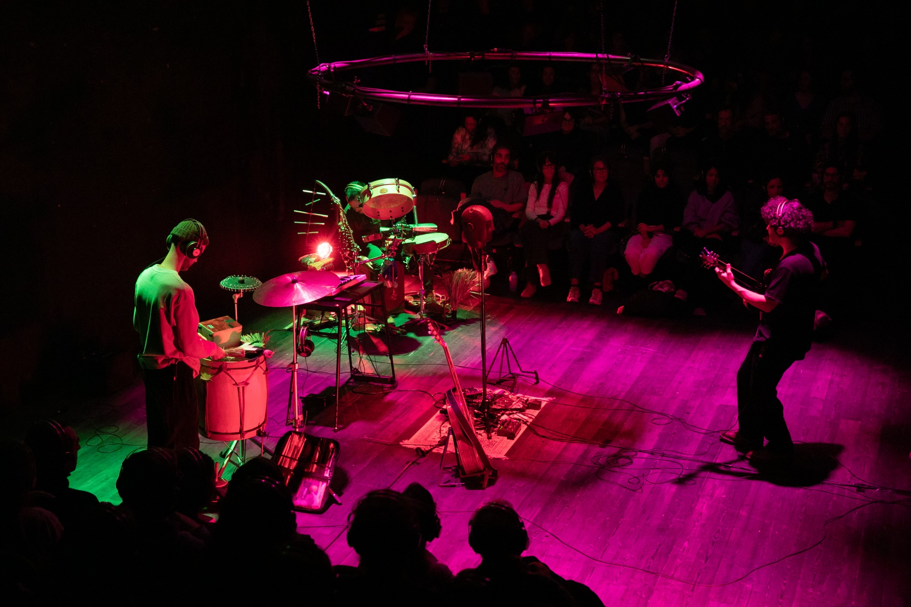

# Real360 Lab · Documentació del laboratori

Aquest document recull el procés de creació del laboratori, tal com es va comprometre al projecte:
*tot el programari i la documentació dels processos de creació es publiquen com a tecnologies obertes.*

<!--
PARA COMPLETAR (Cote / Panorama180). Rellenar solo con lo que se haya hecho de verdad:
fechas, fotos (en docs/img/), modelos del equipo y resultados. Lo que esté pendiente,
dejarlo como «Pendent». Este archivo se publica tal cual.
-->

## 1. El sistema



L'aro es penja horitzontalment sobre el cap binaural (*dummy head*). Els músics toquen al voltant i el públic
escolta amb auriculars el que capta el cap: el so que es mou per l'aro, tal com l'escoltaria una persona al centre.

L'aro té dues configuracions d'altaveus:

| | Configuració d&b (inversió del projecte) | Configuració Genelec (ús actual) |
|---|---|---|
| **Aro** | Estructura metàl·lica de 2 m de diàmetre, penjada horitzontalment | La mateixa |
| **Altaveus** | 6 altaveus d&b audiotechnik *(model)*, equidistants | 4 Genelec 8040B (autoamplificats), en quadrafonia |
| **Amplificació** | Etapa de potència d&b *(model)* | Integrada als Genelec |
| **Captació** | Cap binaural *(model: Neumann KU 100?)* al centre, sota l'aro | El mateix |

Comú a les dues configuracions:

- **Interfície d'àudio:** MOTU 896 Mk3.
- **Taula de so:** Midas Venice, per a les fonts en directe (micròfons, instruments).
- **Programari:** Logic Pro en format surround, amb l'app i el plugin POLAR repartint el senyal de cada pista
  pels altaveus de l'aro.

En quadrafonia, l'ordre dels altaveus és: 1 davant esquerra, 2 davant dreta, 3 darrere esquerra, 4 darrere dreta.

```
fonts en directe ──► Midas Venice ──► MOTU 896 Mk3 ──► Logic Pro + plugin POLAR (una instància per pista)
                                                        ▲                  │
                         app POLAR (ordinador / mòbil) ─┘ posició (UDP)    ▼
                                                     sortides ──► altaveus de l'aro ──► cap binaural ──► auriculars del públic
```

## 2. Muntatge i adaptació del maquinari

*(Com es va construir i penjar l'anell, alçada respecte del cap binaural, cablejat, problemes trobats i com es van resoldre.)*

## 3. Programari

| Peça | Estat |
|---|---|
| App POLAR: panoramització des de l'ordinador i el mòbil, MIDI, sessions | Fet |
| Plugin POLAR: rep la posició de l'app i reparteix el so pels altaveus | Fet (4 altaveus) |
| Kit POLAR: llei de panoramització, pad i moviments automàtics compartits | Fet |
| POLAR amb 6 altaveus (configuració d&b de l'aro) | Pendent |

### Per què un sistema propi

El projecte preveia treballar amb una versió de prova del programari de posicionament per objectes de d&b
audiotechnik. En lloc de dependre d'un programari tancat i d'un sol fabricant, hem desenvolupat **POLAR, un
sistema d'espacialització propi, independent i obert**:

- Funciona amb qualsevol interfície i qualsevol altaveu: el mateix aro sona amb els d&b o amb els Genelec.
- No necessita llicències: el codi és públic (AGPL-3.0) i es pot replicar en altres espais.
- Està pensat per a l'escena: control des del mòbil i per MIDI, moviments automàtics i un plugin per pista al DAW.

<!-- COMPLETAR: por qué se tomó esta decisión (disponibilidad de la versión de prueba de d&b, coste de licencias,
     necesidad de control desde el móvil, etc.). Solo los motivos reales. -->

## 4. Proves i experimentació

*(Sessions de prova al laboratori: dates, què es va provar, enregistraments binaurals.)*

## 5. Pilot artístic

*(Títol, artistes, data i lloc, enllaç al vídeo o a l'enregistrament binaural — escoltar amb auriculars.)*

## 6. Com replicar-ho

*(Passos perquè un altre artista o entitat pugui muntar un anell semblant amb aquest programari.)*
